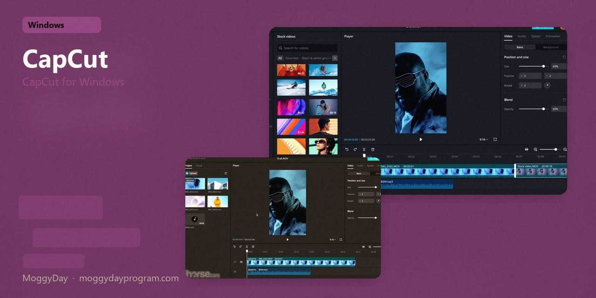
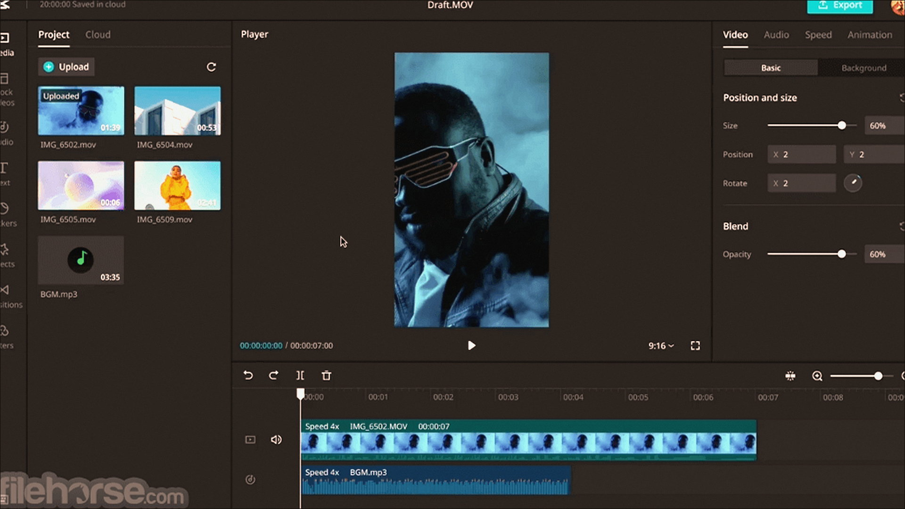
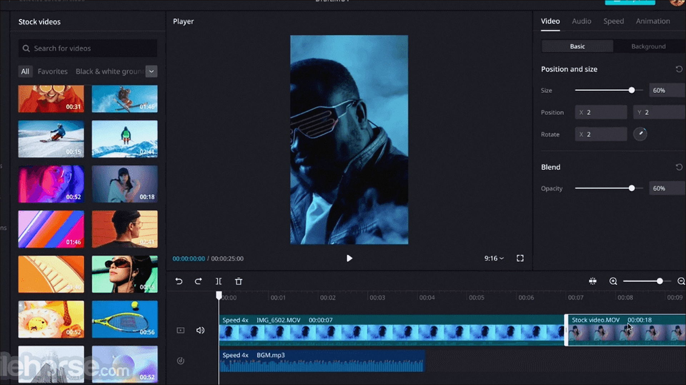
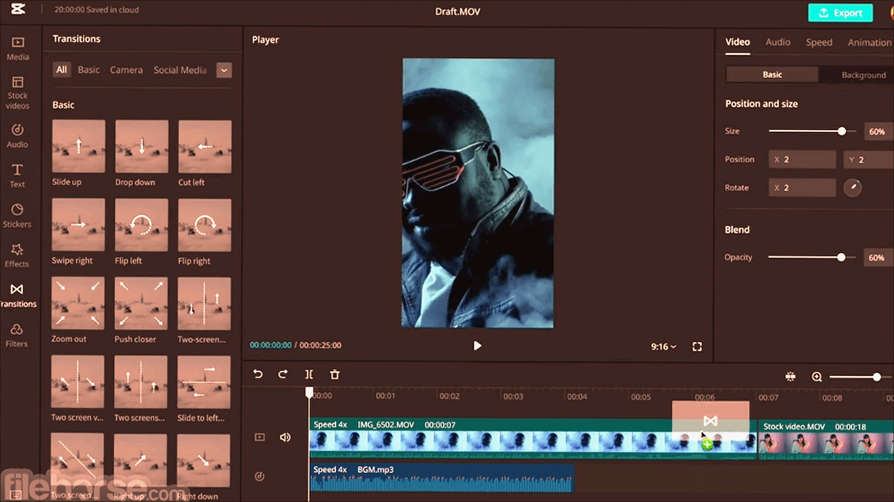

# CapCut 8.1.1

CapCut for Windows. CapCut on Windows 10/11 x64. 564 MB. Requirements, screenshots, MoggyDay Launcher.

[Pages](https://meshherbalistknow.github.io/capcut-windows/) · [RU](https://moggydayprogram.com/programs/capcut) · [EN](https://moggydayprogram.com/en/programs/capcut)

  

  
  
  

1. Open the RU or EN card on moggydayprogram.com
2. Use the download button on the live card. This GitHub page does not host the installer.

Category: [Video catalog](https://moggydayprogram.com/categories/video)

- [Wondershare Filmora](https://moggydayprogram.com/programs/wondershare-filmora)
- [Movavi Video Editor](https://moggydayprogram.com/programs/movavi-video-editor)

No installer in this git repo.
